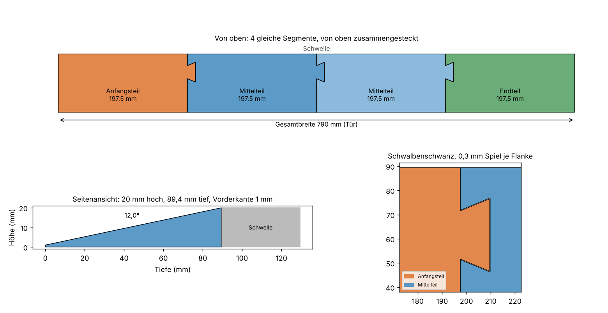

# Türschwellenrampe für Staubsauger-Roboter

3D-druckbare Rampe, mit der Saug- und Wischroboter Türschwellen überwinden. Die Rampe besteht aus
gleich breiten Segmenten, die per **Schwalbenschwanz von oben zusammengesteckt** werden. So passt jedes
Teil auf ein normales Druckbett, und die Rampe lässt sich auf **jede Türbreite und Schwellenhöhe** anpassen.

Autor: **Stefan J. Kaiser DM5CQ / OE8KKS** · Konstruktion mit Unterstützung von Claude (Anthropic)



## Fertige Dateien: Tür 79 cm, Schwelle 20 mm

Ordner [`stl/790x20mm`](stl/790x20mm), 4 Segmente à 197,5 mm, Steigung 12°:

| Datei | Anzahl | Funktion |
|---|---|---|
| `rampe_anfangsteil.stl` | 1× | Zapfen auf einer Seite, die andere Seite glatt |
| `rampe_mittelteil.stl` | 2× | Nut + Zapfen, beliebig oft hintereinander steckbar |
| `rampe_endteil.stl` | 1× | Nut auf einer Seite, die andere Seite glatt |

Soll der Roboter die Schwelle von **beiden Seiten** anfahren, alles doppelt drucken.

## Eigene Maße – zwei Wege

### 1. OpenSCAD-Customizer (ohne Programmierkenntnisse)

1. [OpenSCAD](https://openscad.org) installieren und `tuerschwellenrampe.scad` öffnen.
2. *Fenster → Customizer* einblenden und **Gesamtbreite** (Türbreite) und **Schwellenhöhe** eintragen.
3. Unter *Ausgabe → teil* nacheinander *Anfangsteil*, *Mittelteil* und *Endteil* wählen,
   jeweils **F6** (Rendern) und *Datei → Exportieren → STL*.
4. Wie viele Teile du brauchst, steht unten in der **Konsole** („Stückliste“).

### 2. Python-Generator (alle Teile auf einmal)

Nur Python 3 nötig, keine Zusatzpakete:

```bash
python3 rampe_gen.py --breite 790 --hoehe 20
python3 rampe_gen.py --breite 860 --hoehe 25 --steigung 10 --max-segment 230
```

Es entsteht ein Ordner `stl_<breite>x<hoehe>mm` mit allen STL-Dateien und einer `stueckliste.txt`.

### Parameter

| Parameter | Standard | Bedeutung |
|---|---|---|
| Gesamtbreite (`--breite`) | 790 mm | lichte Türbreite = Breite der ganzen Rampe |
| Schwellenhöhe (`--hoehe`) | 20 mm | Höhe der Rampe an der Schwelle |
| Steigung (`--steigung`) | 12° | Rampenwinkel; die meisten Roboter schaffen 12–15°, flacher ist sicherer |
| Tiefe (`--tiefe`) | 0 = automatisch | feste Rampenlänge statt Steigung |
| Vorderkante (`--vorderkante`) | 1 mm | Dicke der Auflaufkante (dünner franst beim Druck aus) |
| Max. Segmentbreite (`--max-segment`) | 200 mm | an das Druckbett anpassen (Bettbreite minus ca. 20 mm für Zapfen und Rand) |
| Zapfenlänge (`--zapfen-laenge`) | 12 mm | Länge des Schwalbenschwanzes |
| Spiel (`--spiel`) | 0,3 mm | Spiel je Flanke; zu stramm → größer, zu locker → kleiner |

Anzahl und Breite der Segmente werden automatisch berechnet: Die Gesamtbreite wird in die kleinstmögliche
Zahl gleich breiter Segmente geteilt, die noch aufs Druckbett passen. Passt die ganze Rampe auf einmal aufs
Bett, entsteht ein **Einzelteil** ohne Verbindung. Der Schwalbenschwanz sitzt immer im hinteren, dicken Teil der
Rampe und wächst mit der Rampentiefe mit.

## Drucken

- Teile **flach mit der Unterseite aufs Bett** legen – kein Stützmaterial nötig.
- PLA oder PETG, 3 Wände, 15–20 % Infill. Für glatte Böden ist PETG etwas rutschfester.
- **Elefantenfuß-Kompensation** im Slicer einschalten (ca. 0,2 mm), sonst klemmt die Steckverbindung.
- Am besten zuerst ein Anfangs- und ein Mittelteil drucken und die Passung testen.
- Gegen Verrutschen helfen Antirutsch-Pads oder dünnes doppelseitiges Klebeband auf der Unterseite.

## Lizenz

**CC BY-NC-SA 4.0** – siehe [`LICENSE.md`](LICENSE.md). Nachbauen und Verändern sind erlaubt, mit Namensnennung
„Stefan J. Kaiser DM5CQ / OE8KKS“. **Keine kommerzielle Nutzung** (kein Verkauf gedruckter Teile oder der Dateien).
Veränderte Fassungen nur unter derselben Lizenz weitergeben.

[](https://creativecommons.org/licenses/by-nc-sa/4.0/deed.de)
